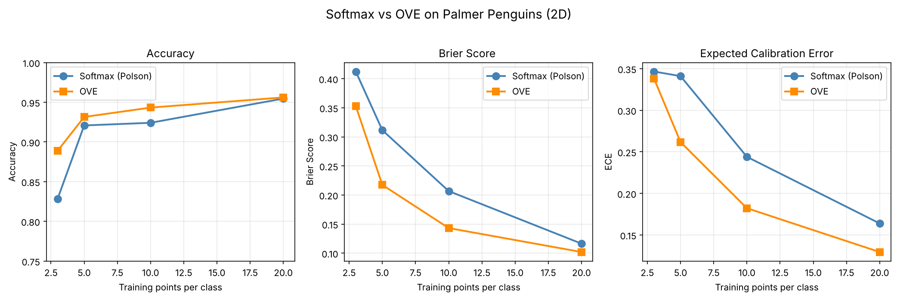
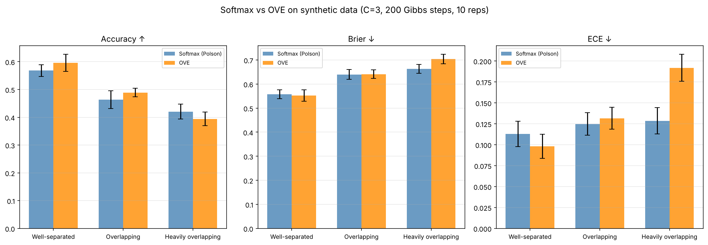

# Multi-class GP classification via Pólya-Gamma augmentation

Code of the project *Multi-Class GP Classification via Pólya-Gamma Augmentation* (Giacomo Grossi,
STAT 625, Rice University, Spring 2026, with Prof. Meng Li). The report is in
[`docs/report.pdf`](docs/report.pdf).

Each of the C classes gets a latent function with an independent Gaussian-process prior,
f<sup>c</sup> ~ GP(0, k). The softmax likelihood couples the classes and is not conjugate to the
Gaussian prior; Pólya-Gamma augmentation (Polson, Scott and Windle, 2013) makes the conditionals
Gaussian again. Two Gibbs samplers are compared:

- **Polson-GP**: the *exact softmax*. Conditioning on the other classes turns the softmax of class
  j into a logistic function of f<sup>j</sup> − C<sub>ij</sub>, with C<sub>ij</sub> = log Σ<sub>k≠j</sub> exp f<sup>k</sup>(x<sub>i</sub>)
  (Holmes and Held, 2006), so the classes are updated **one at a time**.
- **OVE-GP**: the *One-vs-Each* likelihood Π<sub>c'≠y</sub> σ(f<sup>y</sup> − f<sup>c'</sup>), a lower bound to the softmax
  (Titsias, 2016) that can be read as a pairwise composite likelihood (Lindsay, 1988). All of f is
  updated **in one block** through the Woodbury identity (Snell and Zemel, 2021).

Both cost O(CN³) per iteration; they differ in the likelihood and in how well the chain mixes.

## Results

**Experiment 1: how close is OVE to the softmax?** 50,000 logit vectors f<sub>c</sub> ~ N(0, 1), C = 3.

| Correlation | Mean abs. difference | KL(softmax ‖ OVE) | Argmax agreement |
|---|---|---|---|
| 0.996 | 0.041 | 0.023 | 100% |

**Experiment 2: Palmer Penguins** (two standardized bill measurements, three species; RBF kernel
with lengthscale 1, 20 Gibbs steps, 5 chains, 5 random splits).

| Train per class | Accuracy SM / OVE | Brier SM / OVE | ECE SM / OVE |
|---|---|---|---|
| 3 | 0.828 / 0.889 | 0.412 / 0.353 | 0.347 / 0.338 |
| 5 | 0.921 / 0.931 | 0.311 / 0.217 | 0.341 / 0.262 |
| 10 | 0.924 / 0.943 | 0.207 / 0.143 | 0.244 / 0.182 |
| 20 | 0.955 / 0.956 | 0.116 / 0.102 | 0.164 / 0.129 |

On one split (20 per class, 100 steps, 30 burn-in) the effective sample size per draw is 0.44 for
Polson-GP and 0.71 for OVE-GP: the block update mixes faster.



**Experiment 3: longer chains on simulated data.** If OVE wins on Penguins because its sampler
mixes faster, the gap should shrink with longer chains when the data come from a softmax model.
With 200 Gibbs steps (3 chains, 10 replications, 10 training points per class) the two methods are
within one or two standard errors in the well-separated and overlapping scenarios, and the exact
softmax is better calibrated when the classes overlap heavily (Brier 0.663 against 0.704, ECE
0.129 against 0.192).



## Repository

| File | Content |
|---|---|
| `gpclass.py` | kernel, Pólya-Gamma sampler, the two Gibbs samplers, metrics, effective sample size |
| `exp1_likelihood.py` | Experiment 1: likelihood and posterior contours, confidence histogram, Table 1 |
| `exp2_penguins.py` | Experiment 2: Table 2 and its figure; mixing diagnostics and trace plot |
| `exp3_synthetic.py` | Experiment 3: three degrees of class overlap, 200 Gibbs steps |
| `docs/report.pdf` | the report |

```bash
pip install -r requirements.txt
python exp1_likelihood.py      # seconds
python exp2_penguins.py        # seconds
python exp3_synthetic.py       # about half a minute
```

Figures are written to `figures/`. All runs are seeded and reproduce the numbers above.

## Notes and limitations

- The predictive probabilities average the **last state of each chain** (5 chains in Experiment 2,
  3 in Experiment 3), with the latent functions at the test inputs set to their GP conditional mean
  given the training values. Averaging all post-burn-in draws and adding the conditional variance
  would give a fuller posterior predictive.
- The kernel lengthscale is fixed at 1 and not learned.
- PG(1, c) is drawn from its infinite-sum representation truncated at 20 terms.
- In Experiment 3 each class function is a GP draw plus a bump around the class centre, while the
  fitted models have zero-mean GP priors: the labels follow a softmax likelihood, but the data are
  not drawn exactly from the fitted prior.

## References

- N. G. Polson, J. G. Scott and J. Windle (2013). Bayesian inference for logistic models using
  Pólya-Gamma latent variables. *JASA*, 108(504).
- C. C. Holmes and L. Held (2006). Bayesian auxiliary variable models for binary and multinomial
  regression. *Bayesian Analysis*, 1(1).
- M. K. Titsias (2016). One-vs-each approximation to softmax for scalable estimation of
  probabilities. *NeurIPS*.
- J. Snell and R. Zemel (2021). Bayesian few-shot classification with one-vs-each Pólya-Gamma
  augmented Gaussian processes. *ICLR*.
- B. G. Lindsay (1988). Composite likelihood methods. *Contemporary Mathematics*, 80.
- J. W. Miller (2021). Asymptotic normality, concentration, and coverage of generalized posteriors.
  *JMLR*, 22.

## License

MIT
